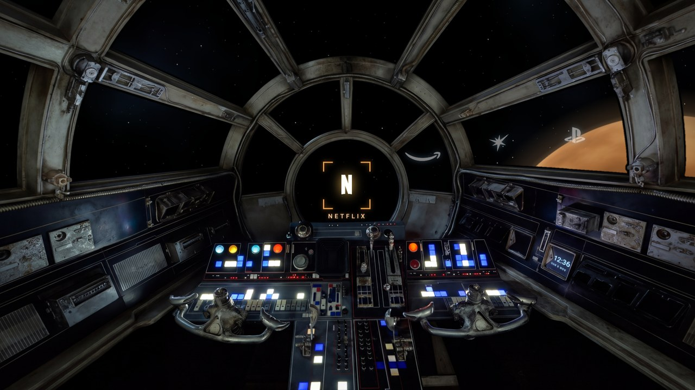
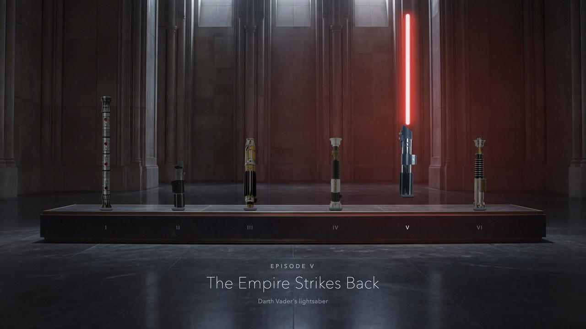
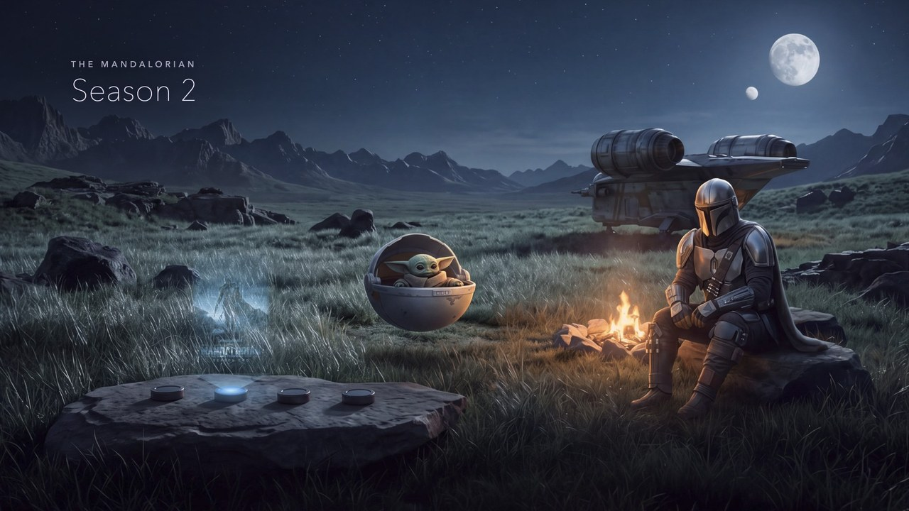
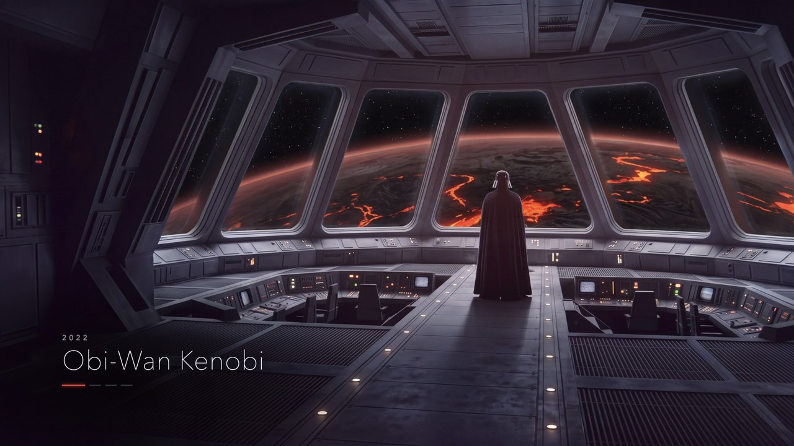
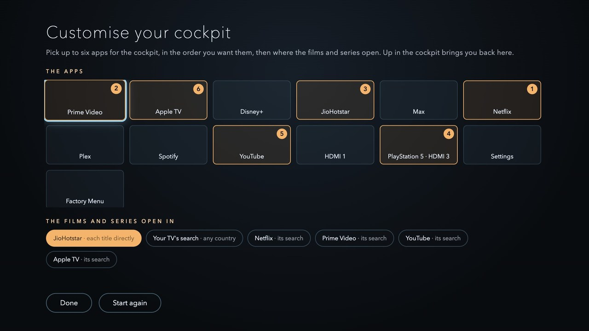

# Star Wars TV

A Star Wars home screen for Android TV and Google TV, built as its own app. You sit in the Millennium Falcon's cockpit,
and your apps are out in space beyond the canopy. The one you pick sits in the centre pane under a targeting reticle;
moving to the next is a short burst of speed, the stars streaking past and the cockpit lurching; opening it is a jump to
hyperspace, and when you come back you drop out at a different planet. The time and date are on the monitor in the
cockpit's right-hand wall. One step down is a hall in the Jedi Temple, where Episodes I to VI are lightsabers on a ledge,
one from each film; the one you pick rises and ignites. One more is a campfire with Din Djarin and Grogu, where four
bounty pucks project The Mandalorian's seasons and its film as holograms. The last is the dark side: Vader on the bridge
of a Star Destroyer, with a different place through the windows for each story: Mustafar, Coruscant, the Death Star
being built and Scarif. OK opens the film or series wherever you watch it.



| | |
|---|---|
|  |  |
|  |  |

Fan-made, for personal use. Not affiliated with or endorsed by Lucasfilm or Disney. The holograms are the posters of The
Mandalorian's seasons and film from [TMDB](https://www.themoviedb.org), the lightsaber hilts are Lucasfilm's own
renders (via Wookieepedia and the StarWars.com Databank), and the app logos belong to Netflix, Amazon, JioHotstar, Sony,
Google and Apple. The cockpit, the hall, the camp and the bridge with its views were made with AI image generation.

## What's here

| | |
|---|---|
| [**Star-Wars-TV.apk**](../../releases/latest) | The app, ready to install, on the Releases page. |
| [**GUIDE.md**](GUIDE.md) | The full guide: install, make it your home screen, customise it, troubleshooting, every prompt used to make the pictures, the brief it was built from, and how to rebuild it. Also as a [PDF](docs/Star%20Wars%20TV%20-%20full%20prompt%20and%20guide.pdf). |
| [**PROMPT.md**](PROMPT.md) | A prompt for a coding assistant that asks what you watch and where, sets Star Wars TV up for you, builds it and installs it on your TV. |
| [**Star-Wars-TV-assets.zip**](../../releases/latest) | Every picture at full resolution, and the generated originals they were made from, on the Releases page. |
| `starwars/`, `starwars-tv/`, `build.sh` | The source: the page, its pictures and tools, and the Android TV app. |

## Make it yours

In the cockpit, press **Up**: **Customise** lights up at the top. Press **OK**. (It also opens by itself the first time.)

- **The cockpit:** up to six of your TV's apps and HDMI inputs, in the order you pick them. Netflix, Prime Video,
  JioHotstar, YouTube, Apple TV and a PlayStation show their logos; any other app shows its name.
- **Where the films and series open:** JioHotstar straight into each title (India), **your TV's own search** (on Google
  TV it lists where each title streams in your country), or the search of any app you picked.

To send the titles straight into another service, add its links to `starwars/config.js` and rebuild, or let
[PROMPT.md](PROMPT.md) find them for your country. Details in [GUIDE.md](GUIDE.md), section 6.

## Install

Star Wars TV needs Android 7 or newer with Android System WebView up to date. Cleaning up the TV first with
[cleanyourtv](https://github.com/Gathin23/cleanyourtv) is optional but worth it: its
[`PROMPT.md`](https://github.com/Gathin23/cleanyourtv/blob/main/PROMPT.md) switches off the ads and the stock launcher's
feeds, and everything it does can be undone.

Install the APK from [Releases](../../releases/latest) with a USB stick and a file manager, or with adb:

```bash
adb connect YOUR-TV-IP:5555
adb install "Star-Wars-TV.apk"
```

It's signed with certificate SHA-256 `71ca03bf2509b6188e931f98d0dc5eade9d73f610cc4dfeca9b299de80a97022` (the same key
as [Hogwarts TV](https://github.com/ikevinadams/hogwarts-tv-home)); check it with
`apksigner verify --print-certs "Star-Wars-TV.apk"`.

To make it the home screen on Android 10 or newer, `adb shell cmd role add-role-holder android.app.role.HOME app.tvhome.starwars 0`;
on Android 7 to 9, `adb shell cmd package set-home-activity app.tvhome.starwars/.HomeAlias`. To switch back, run the same
command with your old launcher's package, or uninstall Star Wars TV. More ways, and the details, in [GUIDE.md](GUIDE.md).

## The remote

| Key | In the cockpit | In the Jedi Temple | At the camp | On the bridge |
|---|---|---|---|---|
| Left / Right | fly to the next app | pick a lightsaber | pick a bounty puck | jump to the next place |
| Down | the Jedi Temple | the camp | the bridge | |
| Up | Customise | back to the cockpit | back to the Jedi Temple | back to the camp |
| OK | jump to hyperspace and open the app | open the film | open the season or the film | open the series or the film |
| Back | | back to the cockpit | back to the Jedi Temple | back to the camp |
| Home | | back to the cockpit | back to the cockpit | back to the cockpit |

## What it does and doesn't do

- **No permissions.** The manifest asks for none: no internet, no accessibility service, nothing at boot. The page and
  its pictures are inside the app, shown in a full-screen WebView.
- It looks up the TV's apps and HDMI inputs (for the cockpit and the Customise panel) and opens them with ordinary intents.
- Films and series open through the app you chose (its link for the title, or its search) or through the TV's own search.
- Your choices are kept by the app on the TV. Nothing leaves the TV.
- The release build offers itself as a home screen but changes nothing on its own: it's Home only once you pick it.

## Built and tested on

A OnePlus TV (C00), Android TV 10, MediaTek m7632 with 1.8 GB of memory, at 1920×1080: about 60 fps in the Jedi Temple,
at the camp and on the bridge (57 to 59 while it jumps between places), and about 36 in the cockpit, whose moving
starfield this TV draws on its processor. It should run on any Android TV or Google TV from Android 7 up; TVs with less
than 1.5 GB of memory may run slower.

## Build it

JDK 17, the Android SDK (platform 35), Python 3 with Pillow and NumPy, and Node.js:

```bash
./build.sh            # starwars-tv/app/build/outputs/apk/release/app-release.apk
./build.sh install    # and install it on the TV adb is connected to
```

Preview the page in a browser with `python3 -m http.server 8780 --directory starwars` (arrow keys and Enter work as on the
remote; add `?tv` for the TV's rendering). Edit `starwars/`, not the copy in `starwars-tv/app/src/main/assets/www`, which
`build.sh` makes. [GUIDE.md](GUIDE.md), section 9, has the rest.

## Licence

The code is under the MIT licence (see `LICENSE`). The pictures are fan art for personal use; the posters, the hilt
renders and the logos belong to their owners and aren't covered by it.
